# MUNCore

**One place for the team that runs a Model United Nations conference:** who is accepted and has paid, who does which task, which position papers are reviewed, and which committee needs what on conference day.

**Website:** [www.mymuncore.com](https://www.mymuncore.com) · **Live demo:** [www.mymuncore.com/demo](https://www.mymuncore.com/demo) · **Demo videos:** [on the home page](https://www.mymuncore.com/#videos) (four short screen recordings, about a minute each)

> **Status: clickable demo with fake data.** Every screen works, but data lives only in your browser (localStorage). There is no real database, login or file upload yet; those come in Phase 1. Open the [demo](https://www.mymuncore.com/demo) and press **Quick tour** (7 screens, about 3 minutes), pick one of four roles, or try the 17-step **Full walkthrough**. Each tour resets the demo when it starts; “Reset demo” brings everything back at any time.

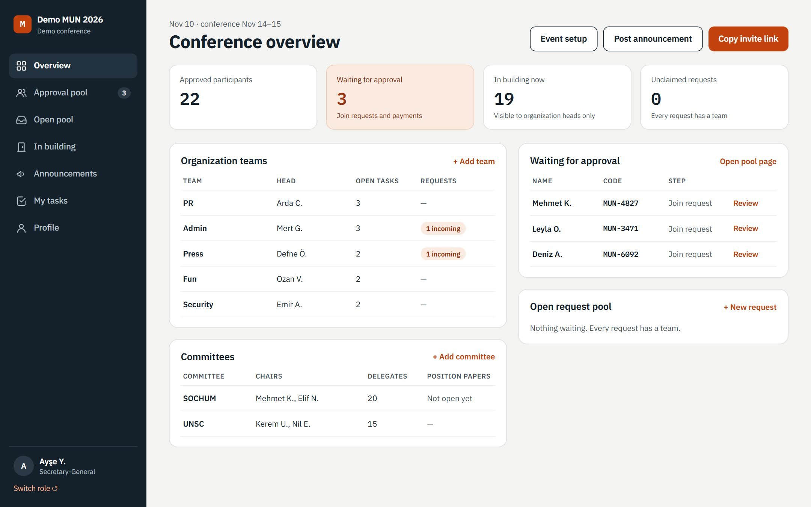

**Contents:** [The problem](#the-problem) · [Roles](#roles) · [Tour by role](#tour-by-role) · [Mobile first](#mobile-first) · [Design decisions](#design-decisions) · [Roadmap](#roadmap) · [How it was built](#how-it-was-built)

## The problem

At a typical high school MUN conference, the organizing work is spread across WhatsApp, Drive and people shouting in hallways:

- **Payment details travel by message**, so a fake “our IBAN changed” message can’t be checked against anything.
- **Parents send the bank transfer**, so the name on the transfer doesn’t match the delegate, and matching is done by hand.
- **Team tasks are given verbally** and get lost.
- **Position papers live in Drive and email**; nobody knows who submitted, and feedback stays verbal.
- **On conference day, committee needs are shouted down the hall** (“water for room 3”), and nobody knows who took the request.
- **No one records who entered the building**, so in an emergency there is no answer to “who is inside?”

Existing tools (MUN Command, mymun, OpenMUN) focus on the committee session itself or on finding conferences. None of them manages how the organizing team works together. MUNCore does only that, and deliberately leaves the session to MUN Command, which my club already uses.

## Roles

| Role | What they do in MUNCore |
|---|---|
| **Applicant** | Joins with the invite link, waits for acceptance, sees payment details and a personal code |
| **Organization heads** (SG, DSG, DG, DDG) | Set up the event, accept people, match payments, see who is in the building, post announcements. All four have the same rights. |
| **Team head** (PR, Admin, Press, Fun, Security) | Assigns tasks inside the team, handles incoming requests, claims requests from the open pool |
| **Team member** | Sees their own tasks, sends requests to the open pool |
| **Committee admin** | An Admin team member placed in a committee by the head of Admin; opens that committee’s requests (water, chairs, photos) |
| **Chair** | Runs committee preparation: study guide, position paper reviews, committee tasks. Doesn’t deal with requests. |
| **Delegate** | Sees everything assigned to them on one screen, with the chair’s feedback |
| **Security** | Records entries at the door by code, without seeing the list |

## Tour by role

### Applicant

<table>
<tr>
<td width="50%">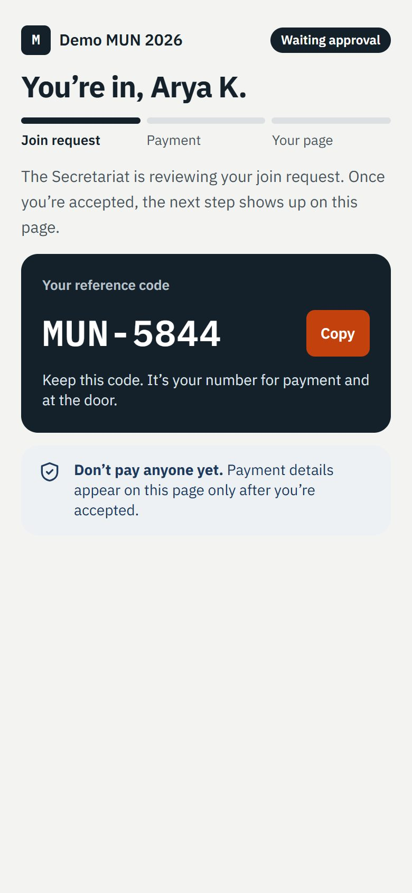</td>
<td width="50%">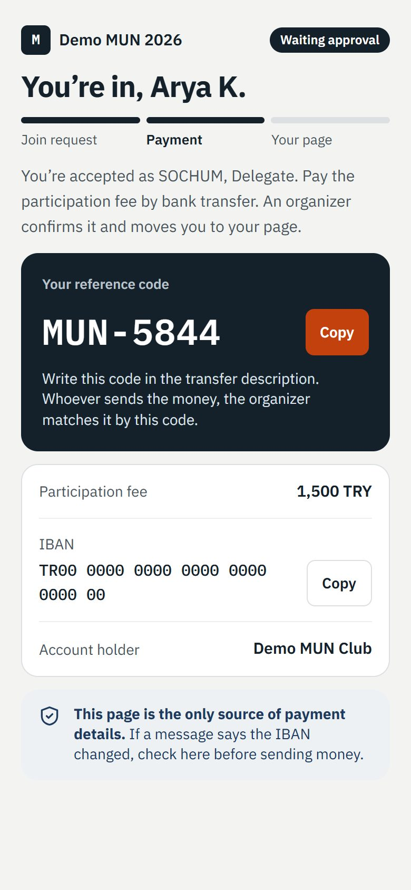</td>
</tr>
</table>

- **One invite link for everyone**, added to the application form. The person enters only an email and a display name (“Arya K.”). No email of their own? A parent’s email works.
- **First the join request is reviewed** (the application itself stays in the Google Form). Payment details stay hidden, with the warning “Don’t pay anyone yet”. A leaked link gets a stranger nowhere.
- **After acceptance**, the page shows the fee, the IBAN and a personal reference code (`MUN-` and four digits). This page is the only source of payment details, so a fake “IBAN changed” message can be checked here.
- **Once the payment is matched**, the person moves to their own page. The same code is their number at the door.

### Organization heads (SG, DSG, DG, DDG)

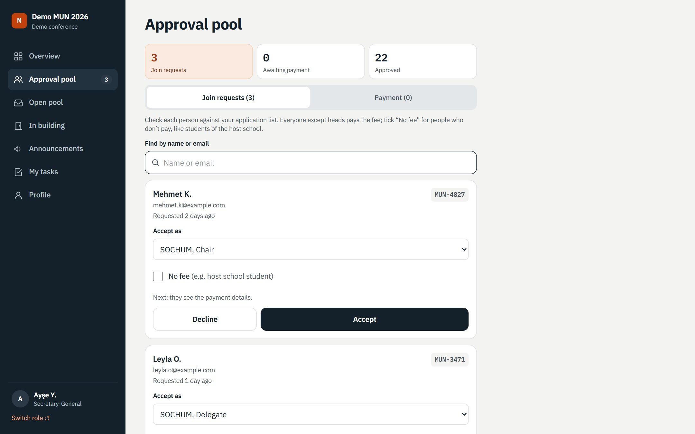

- **Overview** (top of this page): teams, committees, open tasks, who is waiting, unclaimed requests.
- **Approval pool in two steps.** *Join requests*: check against the application list, pick the role, accept or decline. *Payment*: find the transfer by code, or by name when a parent paid, and approve.
- **Fees:** everyone except heads pays. For people who don’t (for example students of the host school) the SG ticks “No fee” and the payment step is skipped. Only “approved” is ever saved: no amounts, receipts or dates.
- **Event setup** with a wizard for a brand-new event: committees, teams and their heads, the invite link, and closing the event when it’s over.
- **Announcements** to everyone, all teams, one team or one committee.

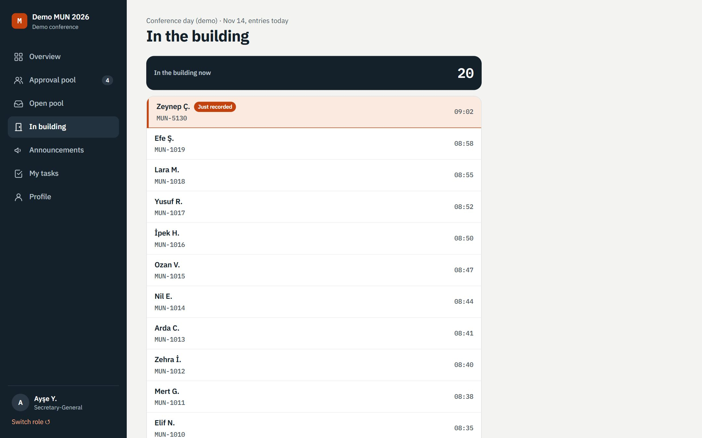

- **Who is in the building**, with check-in times. Only these four people can see this list.

### Team head

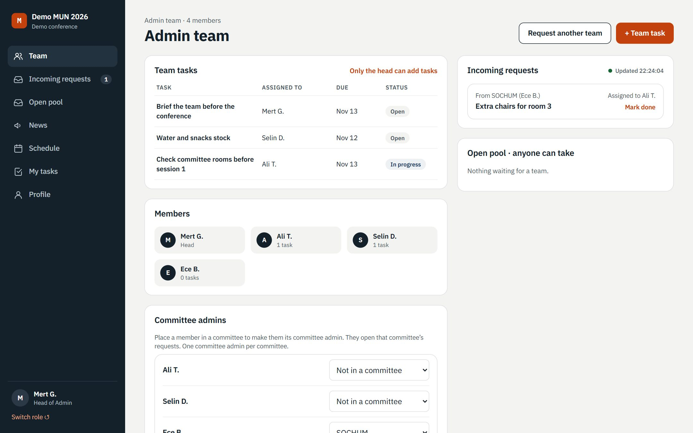

- **Team tasks:** only the head can add them. A task can have several owners.
- **Incoming requests** from committees and other teams. The screen refreshes every 5 seconds, and only while it’s open. The head assigns each request to a member and marks it done.
- **Open pool:** requests that don’t obviously belong to a team wait here until a team head claims them, so no request is left without an owner.

### Committee admin

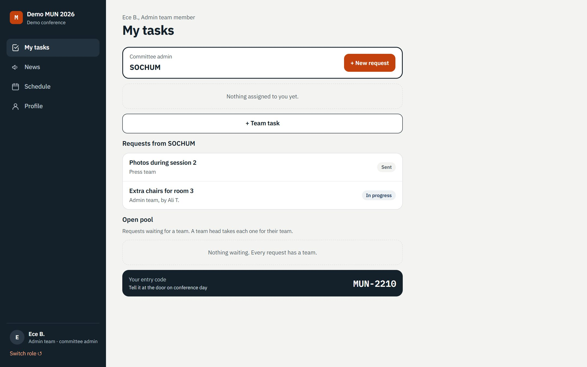

- **A team member with one extra job.** The head of Admin places an Admin team member in a committee (at most one per committee); they become its committee admin.
- **“+ New request”** sends the committee’s needs to a team, or to the open pool when it’s not clear which team. Teams see it as “From SOCHUM (Ece B.)”.
- **The chair stays out of logistics** and focuses on the committee.

### Team member

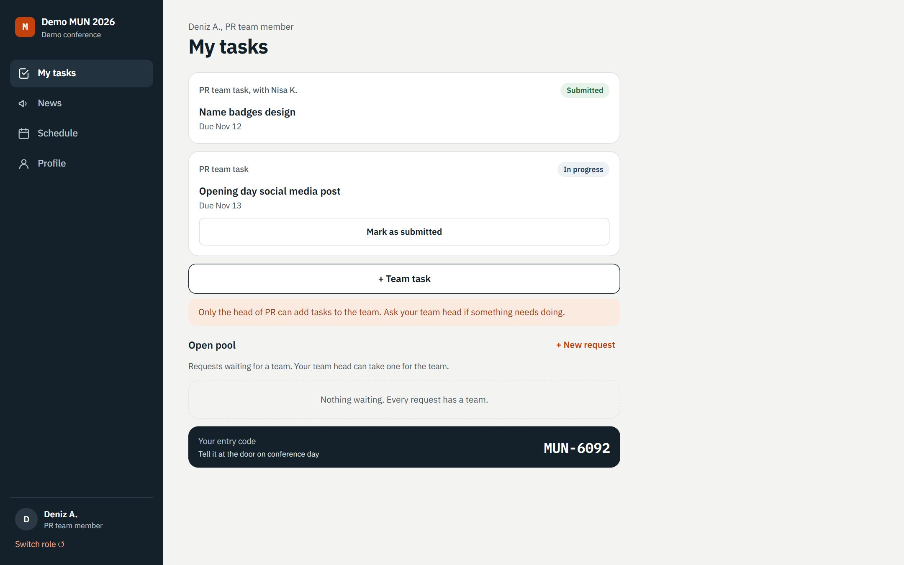

- **My tasks:** only what is assigned to them, with “Mark as submitted”.
- **They can’t assign tasks.** Pressing “+ Team task” explains that only the head can. If something needs doing, they send it to the open pool.

### Chair

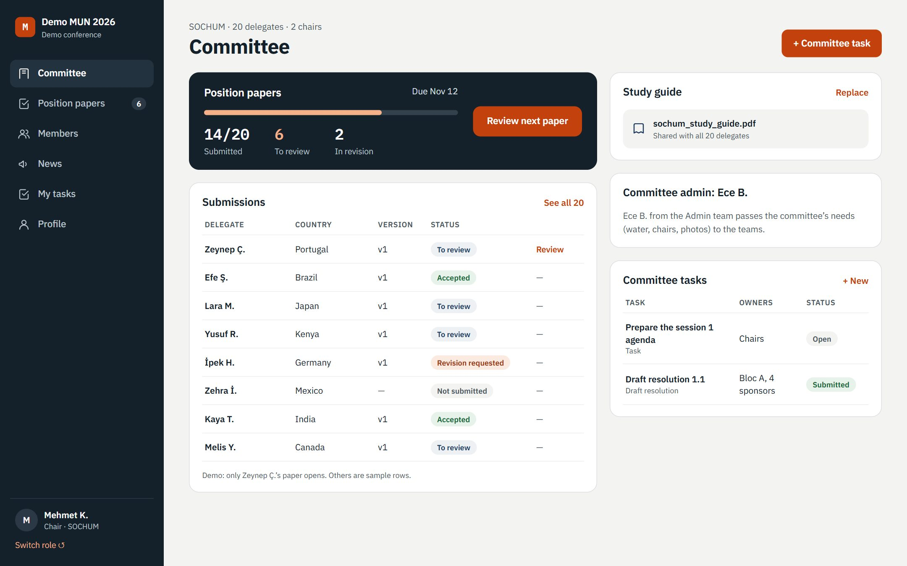

- **Position paper progress** for the whole committee, the study guide and committee tasks.
- **No requests to deal with:** the page only shows who the committee admin is. Committee needs go through them.

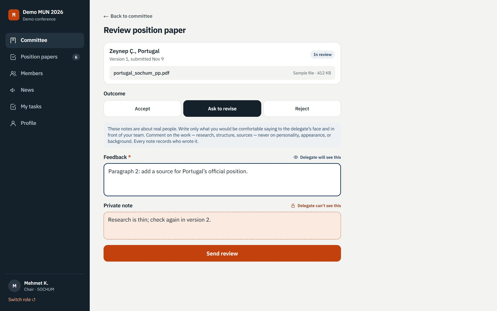

- **Review in three parts:** the outcome (accept, ask to revise, reject), **feedback the delegate will see**, and a **private note the delegate can’t see**, for the chairs only.
- The two boxes are told apart by label, color and border, because writing in the wrong box is the most likely mistake on this screen. A permanent reminder sits above both: comment on the work, never the person.

### Delegate

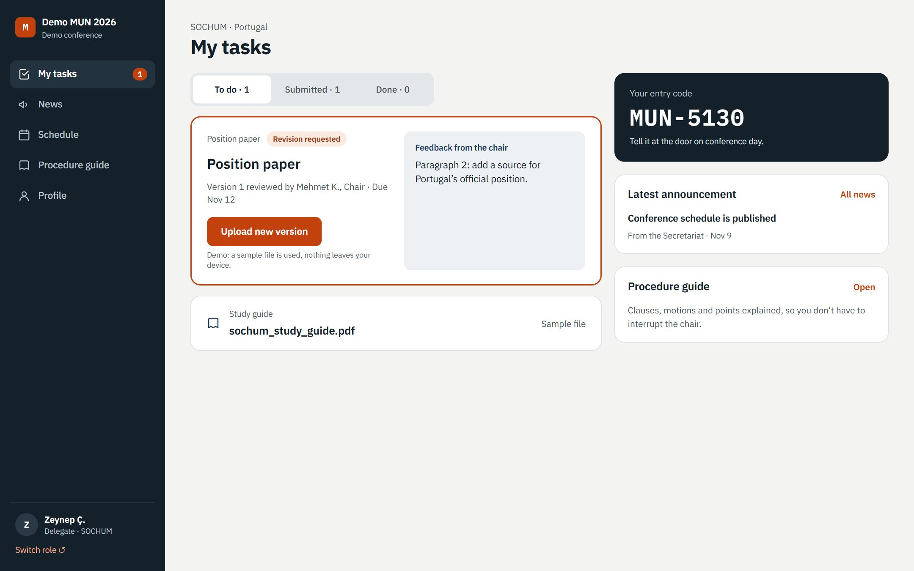

- **Everything on one screen**, in To do / Submitted / Done tabs: the position paper, draft resolutions with the bloc, the study guide.
- **The chair’s feedback is shown next to the paper.** A new version can be uploaded, and earlier versions and their feedback stay in history.
- **The private note never reaches this screen**, not even as hidden data in the page.
- Also: the entry code, announcements for their committee, and a procedure guide (clauses, motions, points) so they don’t have to interrupt the chair.

### Security

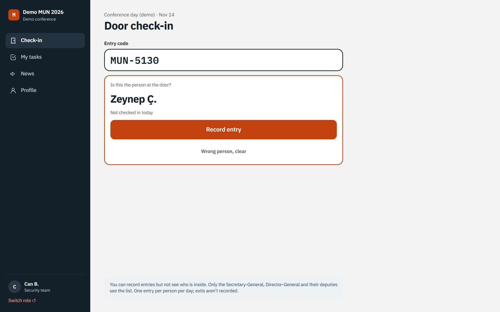

- **The member types the code** and sees only the person’s name, to catch typos, then records the entry.
- **One entry per person per day.** A second scan says “already checked in today”. Exits aren’t recorded.
- **Security can record but not see** who is inside. The head of security has the same check-in screen plus the normal team head screen.

### Guided tours

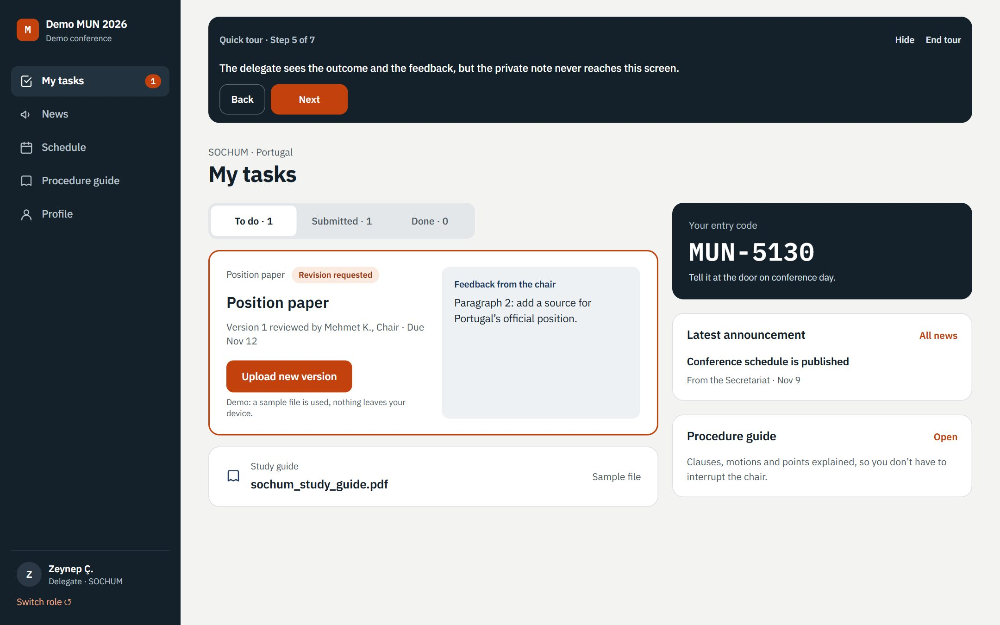

The home page ([www.mymuncore.com](https://www.mymuncore.com)) introduces the product: the problem, what MUNCore does, the roles, the demo videos and how to get in touch. “Log in” works with an invite code instead of a password, and “Sign up” explains that MUNCore is invitation-only. The demo page ([/demo](https://www.mymuncore.com/demo)) is written for someone who has never heard of MUN: a short glossary of MUN terms, four role cards, and two tours.

- **Quick tour:** 7 screens with one sentence each: joining, approval, tasks, review, privacy, the door and requests. It ends on the “What we store” page.
- **Full walkthrough:** the whole story in 17 steps. On the three steps where a rule protects data, it says honestly that the demo enforces the rule on screen only, and that the database will enforce it in Phase 1.

## Mobile first

Most people use MUNCore on a phone, at the door or in a committee room. Every screen is designed at phone width first; the desktop layout came after.

<table>
<tr>
<td>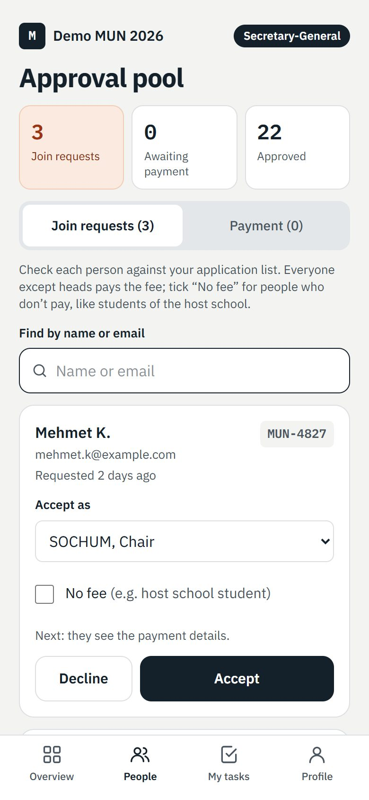</td>
<td>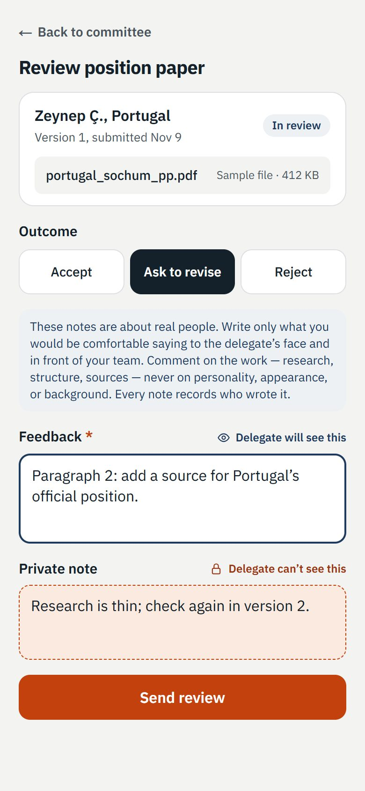</td>
<td>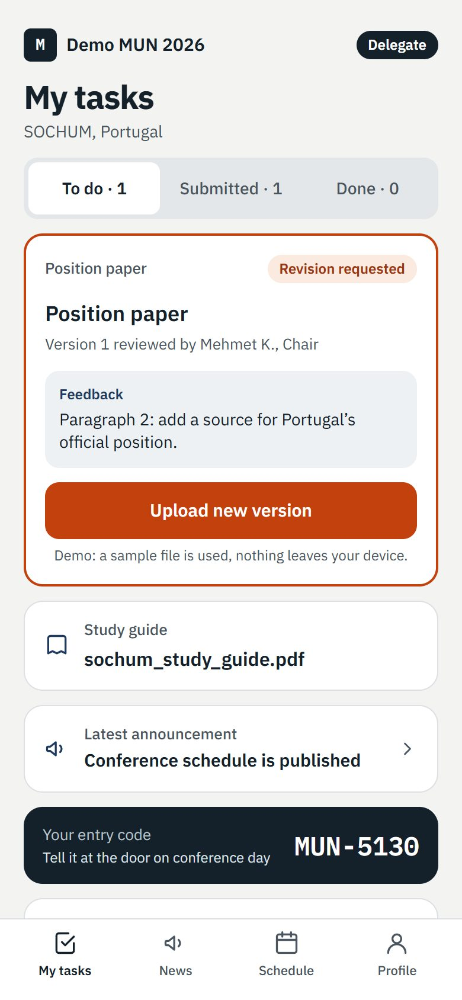</td>
</tr>
<tr>
<td>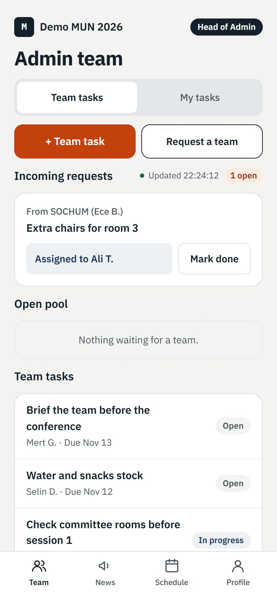</td>
<td>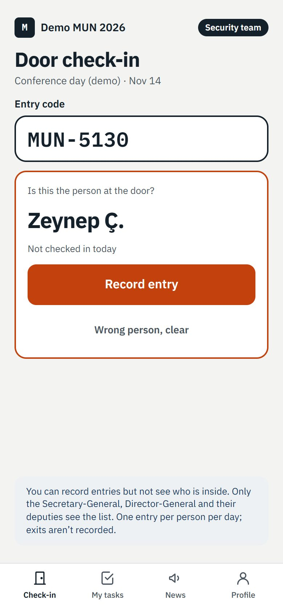</td>
<td>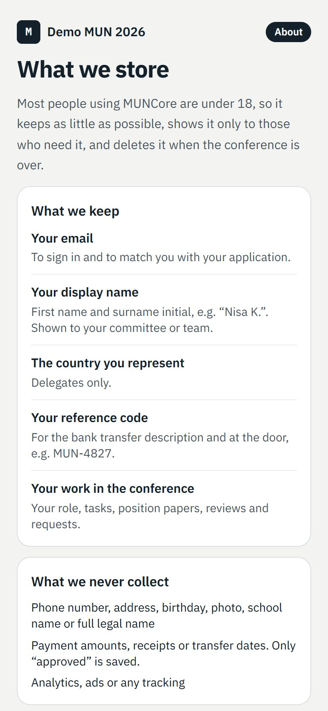</td>
</tr>
</table>

## Design decisions

- **Collect almost nothing.** Users are mostly under 18, so the app keeps only an email, a display name and, for delegates, the country they represent. No phone, address, birthday, photo, school name or financial data. No analytics or tracking.
- **Hiding is not security.** In this demo the rules are enforced on screen only, and the app says so. In Phase 1 every rule moves into the database with Postgres Row Level Security, so a user who calls the API directly still can’t read what they shouldn’t.
- **Seven security tests.** At the end of each phase I test with two accounts, and every answer must be “no”. Examples: “Can a delegate read the chair’s private note?”, “Can security see the list of people in the building?”, “Can a team member assign tasks to their own team?”
- **Delete what is no longer needed.** Private notes are deleted 30 days after the event closes; join requests that weren’t accepted, 7 days after join requests close; everything else after 6 months. The in-app [What we store](https://www.mymuncore.com/privacy) page explains this to users in plain words.
- **No push notifications.** The request screen refreshes every 5 seconds while open. Real emergencies (health, safety) still go by voice or phone; the app keeps the record of who asked and who handled it.
- **Small on purpose.** Committee session tools, awards, AI features and push notifications are out of scope, each with a written reason in [docs/IDEAS.md](docs/IDEAS.md). A finished small product beats an unfinished big one.

## Roadmap

| Phase | What | Status |
|---|---|---|
| 0 | Clickable demo of every screen, mobile first, plus desktop layout and guided demo | ✅ Done |
| 1 | Supabase database with Row Level Security on every table, reviewed by my mentor | Next |
| 2 | Sign-in with a 6-digit email code, real invite links, email delivery | Planned |
| 3–6 | Real tasks, file uploads, requests between phones, building entries | Planned |
| 7 | Closing an event, backups, automatic deletion | Planned |

Before any real student data goes in: privacy notice and terms (Turkish and English), a note for parents, and informing the school.

## How it was built

I designed the product, made the decisions and wrote the specifications: what the app does, who sees what, and what is left out. I built it with heavy help from an AI coding assistant (Claude Code), which I state openly. Every change is a separate, reviewed commit in the private source repository.

- **Stack:** Next.js (App Router), React, TypeScript, Tailwind CSS; deployed on Vercel
- **Planned:** Supabase (Postgres, Row Level Security, Auth, Storage), hosted in Frankfurt (EU)
- **Cost:** free tiers only. Most high school clubs in Turkey can’t pay for subscriptions.

## Documents (in Turkish)

- [Product definition](docs/URUN-TANIMI.md): what the app does, for whom, and the visibility rules
- [Technical spec](docs/SPEC.md): data model, security tests, privacy and legal framework
- [Out of scope, with reasons](docs/IDEAS.md)

## What is in this repository

This repository is a showcase. The complete source code is kept private.

```
README.md            this overview
docs/                product definition, technical spec, out-of-scope list (Turkish), screenshots
excerpts/            two short excerpts from the app, for review
LICENSE              all rights reserved
```

Try the app itself at [www.mymuncore.com](https://www.mymuncore.com) (live demo with sample data at [/demo](https://www.mymuncore.com/demo)).

## Source code

The full source code is available to admissions officers and reviewers on request: write to [hello@mymuncore.com](mailto:hello@mymuncore.com) and I will give read access to the private repository.

## License

Copyright © 2026 Zeynep Ece Çetin. All rights reserved. The material in this repository is shown for review only; it may not be copied, used, modified or distributed without written permission. See [LICENSE](LICENSE).
