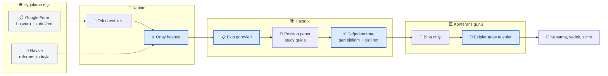
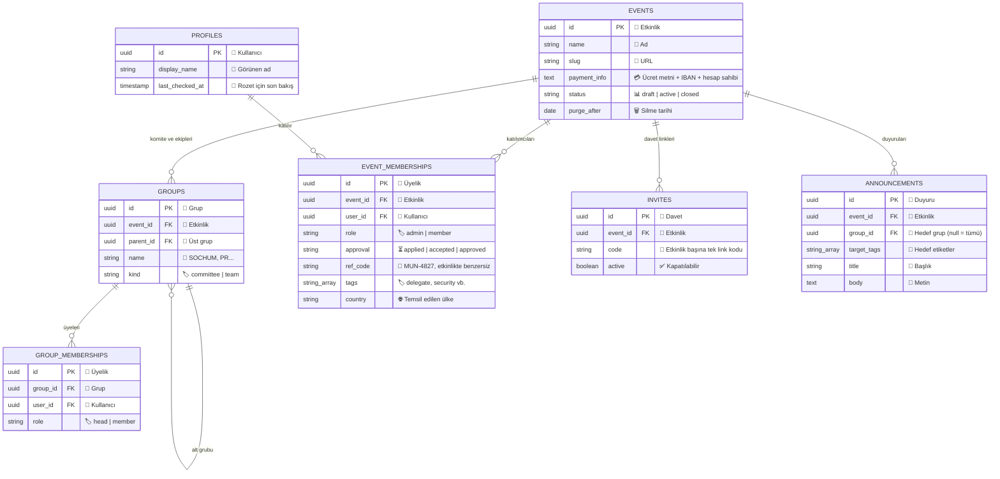
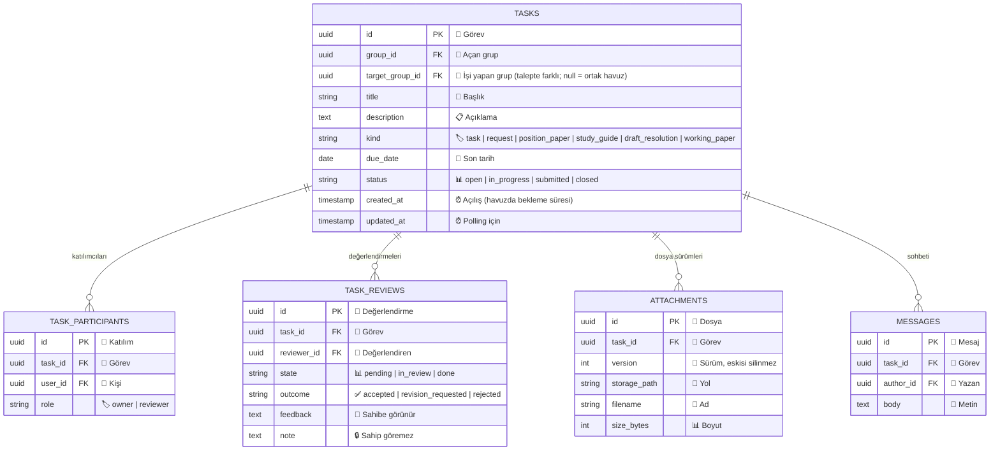
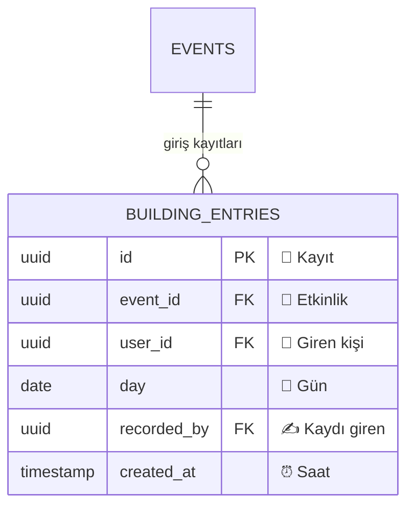

# MUNCore — Proje Belgesi (SPEC)

**Sürüm:** 2.1
**Tarih:** 22 Ekim 2026
**Proje sahibi:** Zeynep
**Önceki sürüm:** 2.0 (22 Ekim). `URUN-TANIMI.md` 3.1'e göre ortak istek havuzu eklendi. 2.0, 1.0'a (22 Ağustos) göre kapsamı `URUN-TANIMI.md` 3.0'a uydurmuştu: organizasyon tarafı öne alındı, komite oturumu v1 dışına çıktı.

> Bu belge **nasıl kurulacağını** anlatır. **Ne yapılacağını** `docs/URUN-TANIMI.md` tanımlar. Çelişirlerse ürün tanımı geçerlidir.

---

## 1. Yönetici özeti

MUNCore, bir Model United Nations (MUN) konferansını **düzenleyen ekibin** işini tek yerden yöneten bir web uygulamasıdır. Telefonda ana ekrana eklenerek uygulama gibi çalışır (PWA).

Bugün bir MUN konferansında organizasyon şöyle yürüyor: kabul edilenlerle iletişim WhatsApp'ta, ödeme bilgisi mesajla elden ele, havaleler isimden elle eşleştiriliyor, ekip içi görevler sözlü veriliyor, study guide'lar ve position paper'lar Drive'da dağınık, konferans günü komitelerin ihtiyaçları bağırarak iletiliyor. Hiçbiri birbirine bağlı değil.

MUNCore, kabul edilen kişinin davet linkinden girdiği andan konferans günü ekipler arası taleplere kadar olan organizasyon işini tek yerde toplar. Komite oturumunun kendisi (yoklama, konuşma süresi, oylama) v1 kapsamında değildir; bu iş için kulüp MUN Command'i kullanmaya devam eder.

**Proje sahipliği:** Bu proje Zeynep'in projesidir. Geliştirmede yoğun şekilde yapay zekâ desteği (Claude Code) kullanılır ve bu açıkça beyan edilir. Ürün tasarımı, mimari kararlar, kapsam yönetimi ve uygulama Zeynep'e aittir. Kod deposu Zeynep'in kendi hesabındadır.

---

## 2. Problem tanımı

Orta ölçekli bir konferansta:

- 3-8 komite, her birinde 15-30 delege
- SG, DSG, DG, DDG; 3-6 organizasyon ekibi (PR, Admin, Security...), her birinin bir başı
- Delege başına 1 position paper, komite başına birden çok karar tasarısı
- Konferans günü komitelerden ekiplere düzinelerce küçük talep

| Problem | Sonuç |
| --- | --- |
| Ödeme bilgisi WhatsApp'ta | Sahte "IBAN değişti" mesajına karşı doğrulama yolu yok |
| Havaleyi veli yapıyor | Bankadaki isim delegeyle uyuşmuyor, eşleştirme elle ve hatalı |
| Ekip görevleri sözlü | Kim ne yapıyor kaybolur |
| Belgeler Drive'da / mailde | Kimin gönderip göndermediği takip edilemez, geri bildirim sözlü kalır |
| Konferans günü talepler sözlü | Talep unutulur, kimin üstlendiği bilinmez |
| Bina girişinde kayıt yok | Acil durumda "binada kim var" sorusunun cevabı yok |

---

## 3. Hedefler

**Birincil hedef:** Bir MUN konferansını düzenleyen ekibin işini (katılım onayı, ekip görevleri, akademik hazırlık, konferans günü talepler) tek uygulamada toplamak.

**İkincil hedefler:**

- Ödeme bilgisinin tek doğru kaynağının uygulama olması
- Herkesin kendine atananı tek ekranda görmesi ("My tasks")
- Görmemesi gereken kişiye verinin veritabanı seviyesinde kapalı olması
- Ücretsiz olması — Türkiye'deki lise kulüplerinin çoğu abonelik ödeyemiyor

**Başarı ölçütü (Kasım):** Demo senaryosunun (`URUN-TANIMI.md` §5) baştan sona sahte veriyle oynanabilmesi ve yedi güvenlik testinin hepsinin "hayır" cevabı vermesi.

---

## 4. Rekabet ortamı

| Araç | Odağı | MUNCore ile ilişkisi |
| --- | --- | --- |
| **mymun** | Konferans listeleme, başvuru, ödeme | Farklı iş, pazar yeri olmak tez değil |
| **MUN Command** | Canlı komite oturumu | Kulüp kullanıyor; MUNCore bu alanda rekabet etmiyor |
| **Model Diplomat** | Delege hazırlığı, otomatik geri bildirim | Kısmen örtüşüyor (geri bildirim) |
| **Muncoordinated** | Açık kaynak komite yönetimi (GPLv3, Firebase) | İncelendi, kod kullanılmıyor |
| **mun.track / OpenMUN** | Konuşmacı listesi, süre, yoklama | Oturum tarafı v1 dışında |

**Konum:** Mevcut araçların çoğu oturum anına odaklanıyor. Konferansı düzenleyen ekibin iç işleyişini (katılım onayı, ekip başı görev dağılımı, ekipler arası talepler) yöneten bir araç yok. MUNCore burada duruyor.

---

## 5. Kapsam

### 5.1 Kapsam içi (v1 / Kasım)

- Etkinlik kurulumu; komite ve organizasyon ekibi yapılandırması, ekip başları
- Tek davet linki, katılım onayı havuzu, kişiye özel referans kodu
- Roller ve etiketler; SG, DSG, DG ve DDG birlikte organizasyon başı olabilir
- Görev yönetimi: çok sorumlulu, çok değerlendirenli; ekip içinde yalnızca başkan görev açar
- Belge yükleme ve değerlendirme (study guide, position paper, karar tasarısı): sonuç + görünür geri bildirim + gizli not, revizyon
- Göreve bağlı sohbet
- Hedefli duyurular (etkinlik, komite, ekip)
- Usul rehberi (statik)
- Konferans günü: ekipler arası talepler (5 saniyelik yenileme), ortak istek havuzu, bina giriş kaydı
- Etkinlik kapatma, yedekleme, saklama süresi

### 5.2 Kapsam dışı

| Dışarıda | Gerekçe |
| --- | --- |
| Başvuru toplama ve kabul/red | Google Form'da kalır, hassas veri sisteme girmez |
| Ödeme işleme | Uygulamaya finansal veri girmez; yalnızca organizatörün onayı |
| Komite oturumu (yoklama, sayaçlar, motion, oylama) | MUN Command'in alanı. `IDEAS.md` |
| Performans notları ve ödül forumu | Oturum verisine bağlı. `IDEAS.md` |
| Serbest mesajlaşma, birebir DM | Moderasyon yükü ve güvenlik riski |
| Push bildirim, Realtime | Talep ekranı 5 saniyede bir yenileniyor |
| Mağaza sürümü | Web PWA yeterli |
| Çoklu dil arayüz | Arayüz yalnızca İngilizce |

---

## 6. Kullanıcılar ve roller

Kullanıcılar lise öğrencileridir (13 yaş üstü). Türkiye ve ABD'de kullanılacaktır.

| MUN görevi | Uygulama rolü | Kapsam |
| --- | --- | --- |
| SG, DSG, DG, DDG | Organizasyon başı (`admin`) | Etkinliğin tamamı |
| Ekip başı (Head of PR, Admin, Security...) | Grup başı (`head`) | Kendi ekibi |
| Chair, co-chair | Grup başı (`head`) | Kendi komitesi |
| Ekip üyesi, delege | Üye (`member`) | Kendi grubu |

Rol **grup bazlıdır**. Bir kişi etkinlikte üye, kendi grubunda baş olabilir. Bir kişi aynı etkinlikte yalnızca bir grupta yer alır; farklı etkinliklerde yer alabilir.

---

## 7. Sistem akışı

---

## 8. Teknik mimari

| Katman | Seçim | Gerekçe |
| --- | --- | --- |
| Arayüz | Next.js (App Router) + React + TypeScript | Tek koddan web + PWA |
| Stil | Tailwind CSS v4 | Hızlı, öğrenmesi kolay |
| Veritabanı & kimlik | Supabase (Postgres) | RLS, auth, e-posta hazır |
| Dosya | Supabase Storage | Aynı ekosistem |
| Barındırma | Vercel | Ücretsiz katman yeterli |
| Bölge | Frankfurt (AB) | TR + ABD karma kitle için orta nokta |
| E-posta | Harici SMTP (Resend, Brevo vb.) | Supabase'in varsayılan servisi saatte 2 mesajla sınırlı |

**Tasarım ilkesi:** Mobil öncelikli. Her ekran önce telefon genişliğinde tasarlanır. Referans arayüz: `ui-reference/`.

**Güncelleme yöntemi:** Talep ekranı 5 saniyede bir sorgu atar (polling). Yalnızca o ekranda çalışır, sekme arka plandayken durur, yalnızca `updated_at` son kontrolden sonra olan satırları çeker. Diğer ekranlar açıldıklarında güncellenir. Realtime ve push bildirim yoktur.

**Maliyet:** Alan adları yıllık ~$30. Supabase ve Vercel ücretsiz katmanları bu ölçek için yeterlidir.

---

## 9. Veri modeli

Üç katman: **etkinlik ve üyelik**, **görev ve belge**, **konferans günü**.

### 9.1 Etkinlik ve üyelik

**Notlar:**
- `payment_info` yalnızca organizatörün yazdığı ödeme talimatıdır. Kimin ödediğine dair hiçbir finansal veri tutulmaz; yalnızca `approval` değişir.
- `ref_code` hem havale eşleştirmede hem bina girişinde kullanılır.
- Davet artık kişiye özel değil, etkinlik başına tek linktir. Linkten giren `applied` olarak başvuru havuzuna düşer. SG kabul edip rolünü seçince `accepted` olur (ödeme havuzu); ödeme doğrulanınca `approved`. Başlar (ekip başı, organizasyon başı) ve SG'nin "No fee" işaretlediği kişiler `applied` → `approved` geçer; ücretsizlik nedeni saklanmaz. `applied` kalanlar başvuru dönemi kapandıktan 7 gün sonra silinir **[Z]** (24 Ekim).
- Giriş: Supabase Auth e-posta kodu (OTP, 6 hane) **[Z]** (24 Ekim). Şifre tutulmaz. Harici SMTP şart (`YAPILACAKLAR.md`).

### 9.2 Görev, belge, değerlendirme, talep

**Değerlendirme sonuç seçenekleri:**

| Tür | Seçenekler |
| --- | --- |
| Position paper | Accepted / Revision requested / Rejected |
| Karar tasarısı, working paper | Sonuç yok; chair geri bildirim yazabilir |
| Görev, study guide, talep | Sonuç yok, yalnızca durum |

**Talep:** `kind = request`. `group_id` talebi açan grup (komite veya ekip), `target_group_id` işi yapacak ekip. Talebi açan grup ve hedef ekip görür; hedef ekibin başı bir üyeye atar.

**Ortak istek havuzu:** `kind = request` ve `target_group_id IS NULL` olan satırlar. Kurallar `URUN-TANIMI.md` §3'te; uygulama:

- **Kim yazar ve okur (RLS):** Etkinliğin organizasyon başları (`event_memberships.role = 'admin'`: SG, DSG, DG, DDG) ve herhangi bir organizasyon ekibinde (`groups.kind = 'team'`) `group_memberships` satırı olanlar (üye ya da baş). Komite grupları (`kind = 'committee'`) bu koşulu sağlamaz: **chair'ler ve delegeler** havuz satırlarını ne okur ne yazar. `INSERT` politikası `target_group_id IS NULL` satırı için aynı koşulu arar.
- **Organizasyon ekibi üyesi** (`group_memberships.role = 'member'`) yalnızca `target_group_id IS NULL` ile talep açabilir; `INSERT` politikası üyenin dolu `target_group_id` göndermesini reddeder. Başka ekibe doğrudan talep komite adminleri, ekip başları ve organizasyon başlarındadır; chair talep açmaz **[Z]**. Komite admini: Admin ekibinin, Head of Admin'in bir komiteye yerleştirdiği üyesi (komite başına en fazla bir).
- **Üstlenme:** Yalnızca ekip başı yapabilir. Tek bir koşullu güncelleme: `UPDATE tasks SET target_group_id = <kendi ekibi>, updated_at = now() WHERE id = $1 AND target_group_id IS NULL`. Etkilenen satır 0 ise başka bir ekip önce üstlenmiştir; arayüz talebi havuzdan düşürür. İki ekibin aynı talebi alması böylece veritabanı seviyesinde imkânsızdır.
- **Kapatma:** Havuzdaki (`target_group_id IS NULL`) satır `closed` yapılamaz; önce bir ekibe bağlanmalıdır. `UPDATE` politikası bunu da kontrol eder.
- **Yenileme:** Havuz küçük olduğu için her 5 saniyelik turda üstlenilmemiş satırların tamamı okunur (`updated_at` süzgeci yok). Böylece başka ekibin üstlendiği talep sonraki turda listeden düşer.
- **Bekleme süresi:** `now() - created_at`; organizasyon başlarının ekranında "waiting 12 min" olarak gösterilir.

**Bloklar:** Karar tasarısı için ayrı alt grup açılmaz. Tek görev açılır, blok üyelerinin hepsi `owner` olur.

**Model açıklığı:** Kriz komitesi direktifleri ileride bu yapıyla karşılanabilir (sahip, değerlendiren, sonuç, gizli not).

### 9.3 Konferans günü

- `(event_id, user_id, day)` benzersizdir: günde tek kayıt. Çıkış kaydı **yoktur**.
- Güvenlik ekibi `INSERT` yapabilir, `SELECT` yapamaz.
- Numaradan görünen adı göstermek için `SECURITY DEFINER` bir fonksiyon: girdi `ref_code`, çıktı yalnızca `display_name`. Yalnızca çağıran kişi o etkinliğin güvenlik ekibindeyse veya organizasyon başıysa çalışır. **Mentor incelemesinde özel olarak bakılacak.**

### 9.4 v1 dışı, model açık

`sessions`, `session_segments`, `motions`, `attendance`, `speaking_records`, `performance_notes`, `award_nominations`, `forum_posts` Kasım'da kurulmaz. Hepsi `groups` tablosuna bağlanacağı için eklendiklerinde mevcut tabloların değişmesi gerekmez. Tasarım notları `IDEAS.md`'de.

---

## 10. Gizlilik ve güvenlik

### 10.1 Veri minimizasyonu

Tutulan kişisel veri: **e-posta adresi, görünen ad, temsil edilen ülke.** Telefon, adres, doğum tarihi, fotoğraf, okul adı, gerçek tam ad **toplanmaz**. Finansal veri (tutar, dekont, tarih, hesap bilgisi) **toplanmaz**. Analitik, reklam ve üçüncü taraf izleme yoktur.

Başvuru aşamasındaki ayrıntılı veri Google Form'da kalır ve sisteme girmez.

### 10.2 Görünürlük matrisi

| Veri | Görebilen | Göremeyen |
| --- | --- | --- |
| Ekip görevleri | Ekip üyeleri, ekip başı, organizasyon başları | Diğer ekipler, delegeler |
| Komite görevleri | Komite üyeleri, chair'ler, organizasyon başları | Diğer komiteler |
| Talepler | Açan grup, hedef ekip, organizasyon başları | Diğer gruplar |
| Ortak istek havuzu (`target_group_id IS NULL`; okuma ve yazma) | Organizasyon ekibi üyeleri, ekip başları, organizasyon başları | **Delegeler, chair'ler** |
| Değerlendirme sonucu ve geri bildirim | Sahibi, değerlendiren, organizasyon başları | — |
| Gizli not | Değerlendiren, organizasyon başları | **Görev sahibi** |
| Katılım havuzu ve referans kodları | Organizasyon başları; kişi yalnızca kendi kodunu | Diğer katılımcılar |
| Bina giriş listesi | Organizasyon başları | **Güvenlik ekibi dahil** diğer herkes |
| Duyurular | Hedeflenen grup ve etiketler | Hedef dışındakiler |

Bu kısıtlar **veritabanı seviyesinde (RLS)** uygulanır. Arayüzde gizlemek yeterli değildir.

### 10.3 Yedi güvenlik değişmezi

Her faz sonunda iki test hesabıyla denenir. Hepsinin cevabı **hayır** olmalı:

1. Etkinlik A'nın yöneticisi, etkinlik B'den veri okuyabiliyor mu?
2. Komite A'daki delege, komite B'nin görevlerini görebiliyor mu?
3. Göreve dahil olmayan üye, o görevin sohbetini okuyabiliyor mu?
4. Görev sahibi, değerlendirenin gizli notunu okuyabiliyor mu?
5. Ekip üyesi (baş olmayan), ekibine görev açabiliyor mu?
6. Organizasyon başı olmayan biri (güvenlik ekibi dahil), bina giriş listesini görebiliyor mu?
7. Dosya bağlantısı doğrudan girildiğinde yetkisiz indirme mümkün mü?

### 10.4 Hassas veri kuralları

Gizli notlar ve geri bildirimler, 18 yaş altı öğrenciler hakkında akranlarının yazdığı değer yargılarıdır. Kurallar:

1. **Görev sahibi gizli notu hiçbir koşulda göremez**
2. **Gizli notlar etkinlik kapandıktan 30 gün sonra silinir** (diğer veriler 6 ay sonra; gizli notlar daha kısa)
3. **Anonim yorum yoktur** — her kaydın yazarı görünür
4. **Değerlendirme ekranında görünür ve gizli alanlar açıkça ayrılır** — etiket ve renkle

Her iki yazım alanının üstünde kalıcı dil uyarısı bulunur:

> *These notes are about real people. Write only what you would be comfortable saying to the delegate's face and in front of your team. Comment on the work — research, structure, sources — never on personality, appearance, or background. Every note records who wrote it.*

### 10.5 Yasal çerçeve

Kullanıcılar 18 yaş altı olduğundan Türkiye'de KVKK, ABD'de eyalet düzeyindeki çocuk veri düzenlemeleri geçerlidir. Tüm kullanıcıların 13 yaş üstü olması şarttır (COPPA eşiği).

Gerçek kullanıcı verisi girmeden önce tamamlanması gerekenler:

- Gizlilik metni ve kullanım koşulları (TR + EN)
- Verilerin AB'de tutulduğu bilgisi
- Hesap silme özelliğinin çalıştığının doğrulanması
- Saklama sürelerinin teknik olarak uygulanması
- Okul idaresinin bilgilendirilmesi, kulüp faaliyeti olarak kayıt
- Velilere bilgilendirme notu

Hesaplar reşit olmayan proje sahibi adına açılamayacağından veli adına açılır; veri sorumlusu velidir.

---

## 11. İş paketleri

Bir odaklı gün ≈ 4 saat kesintisiz çalışma.

| Faz | İçerik | Gün |
| --- | --- | :---: |
| 0 | Kurulum: Next.js, Vercel, alan adı, referans arayüzün eklenmesi | 3 |
| 1 | Veri modeli ve RLS temeli + mentor güvenlik incelemesi | 10 |
| 2 | Giriş, davet linki, onay havuzu, referans kodu, SMTP | 7 |
| 3 | Gruplar, ekip başı, görevler, "My tasks" | 8 |
| 4 | Belgeler: yükleme, sürüm, değerlendirme (sonuç + geri bildirim + gizli not) | 7 |
| 5 | Duyurular, görev sohbeti, usul rehberi | 5 |
| 6 | Konferans günü: talepler + polling, bina girişi | 6 |
| 7 | Etkinlik kapatma, yedek, saklama süreleri | 3 |
| 8 | Demo hazırlığı ve yedi güvenlik testi | 4 |
| — | Yasal iş paketi (gerçek kullanıcıdan önce) | 3 |

**Toplam ~56 odaklı gün.** Kasım'a bu tempoyla tamamı yetişmez. Öncelik: Faz 0-4 ve 6'nın talep kısmı. Gerisi `URUN-TANIMI.md` §9'daki kesme sırasıyla ertelenir ve demoda açıkça beyan edilir.

```mermaid
gantt
    accTitle: Faz Sıralaması
    accDescr: Faz 1 her şeyin temelidir ve aceleye getirilmemelidir. Faz 6 talep akışı demonun omurgasıdır.
    dateFormat X
    axisFormat %s

    section Temel
    Faz 0 Kurulum            :a0, 0, 3
    Faz 1 Veri modeli RLS    :crit, a1, 3, 10
    Faz 2 Giriş ve havuz     :a2, 13, 7

    section Çekirdek
    Faz 3 Görevler           :b3, 20, 8
    Faz 4 Belgeler           :b4, 28, 7
    Faz 5 Duyuru ve rehber   :b5, 35, 5

    section Konferans günü
    Faz 6 Talepler ve giriş  :crit, c6, 40, 6
    Faz 7 Kapatma            :c7, 46, 3

    section Kapanış
    Faz 8 Demo ve testler    :crit, c8, 49, 4
```

---

## 12. Riskler

| Risk | Etki | Azaltma |
| --- | --- | --- |
| **RLS yanlış kurulur** | Veri sızıntısı; en ciddi risk | Faz 1'de mentor incelemesi, yedi test her fazda |
| **Takvim** | Ekim–Kasım erken başvuru dönemiyle çakışıyor | Kesme sırası önceden belirlendi; demo minimum omurgası tanımlı |
| Güvenlik ekibi isim fonksiyonu | Yanlış kurulursa herkesin bilgisine kapı | Dar kapsam, mentor incelemesi, değişmez 6 |
| Chair'in yanlış kutuya yazması | Gizli not delegeye görünür olur | Alanlar etiket ve renkle ayrılır |
| E-posta altyapısı | Davet ve giriş e-postası gitmez | Alan adı erken alınır, SMTP Faz 2'den önce kurulur |
| Kapsam şişer | Takvim tutmaz | Yeni fikirler `IDEAS.md`'ye, v1 kilitli |
| Deneyimsizlik | Yavaşlama | Haftalık mentor, anlaşılmayan kodun kabul edilmemesi |
| Yasal yükümlülük | Ciddi | Veri minimizasyonu, okul bilgilendirmesi, saklama süreleri |

---

## 13. Destek yapısı

**Mentor (haftada 1-2 saat):** Tıkanma noktalarında yönlendirme, karar gözden geçirme. Kod yazmaz — proje sahipliği Zeynep'te kalır.

**Güvenlik incelemesi (Faz 1 sonunda, 2-3 seans):** RLS politikaları, çoklu etkinlik izolasyonu, `SECURITY DEFINER` fonksiyonları (özellikle güvenlik ekibinin isim sorgusu), Storage politikaları.

**Yapay zekâ desteği:** Claude Code geliştirme boyunca yoğun şekilde kullanılır. Bu açıkça beyan edilir.

---

## 14. Sonraki adımlar

1. Bilgisayar kurulumu (VS Code, Git, Claude Code) — yapılmadıysa
2. Next.js projesinin kurulması, belgelerin `docs/` klasörüne, referans arayüzün `ui-reference/` klasörüne yerleştirilmesi
3. Vercel hesabı ve ilk yayın
4. Alan adının alınması (DNS zinciri yüzünden öne çekildi)
5. ~~Giriş yöntemi kararı~~ — e-posta kodu (OTP), 24 Ekim
6. Mentor görüşmesi
7. Faz 1

---

## 15. Sonradan detaylandırılacaklar

- Position paper revizyon döngüsünün nihai hali
- Usul rehberi içeriği
- Demo tarihi ve katılacak MUN yetkilileri
